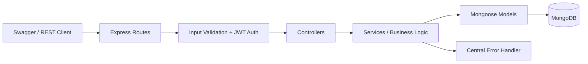

# 🎬 Movie Reviews — מטלה 1

REST API מלא למאגר סרטים וביקורות, בהתאם לדרישות המטלה.

**טכנולוגיות:** Node.js 20.19+, Express 5, TypeScript, MongoDB + Mongoose, JWT, Swagger/OpenAPI 3, Vitest, Supertest, MongoDB Memory Server.

> זו מטלת **Backend / REST API**. לא נדרש ממשק משתמש (Frontend). בדיקות והדגמה מתבצעות דרך Swagger או כלי REST.

## מה המערכת יודעת לעשות?

| דרישה | מימוש |
| --- | --- |
| ניהול סרטים | יצירה, הצגה, חיפוש, עריכה ומחיקה |
| נתוני סרט | שם, שנה, ז'אנר, במאי, שחקנים, תיאור |
| ניהול ביקורות | יצירה, הצגה, עריכה ומחיקה, עם דירוג 1–10 וטקסט |
| סטטיסטיקות סרט | מספר ביקורות ודירוג ממוצע (מעודכנים לאחר כל שינוי) |
| ניהול משתמשים | הרשמה, כניסה, צפייה בפרופיל, מנהל/משתמש |
| הרשאות | JWT, מנהל סרטים; משתמש עורך רק ביקורת שלו; מנהל יכול למתן |
| מסד נתונים | MongoDB עם Mongoose, אינדקס ייחודי למניעת ביקורת כפולה |
| תיעוד | Swagger UI + מסמך OpenAPI מלא |
| בדיקות | Unit + Integration/API, עם מקרי הצלחה ושגיאה |
| איכות קוד | Routes → Controllers → Services → Models; ולידציה וטיפול מרכזי בשגיאות |

## 1. מה צריך להתקין? (Windows / macOS / Linux)

1. **Node.js 20.19 ומעלה** — מומלץ Node.js 22 LTS (כולל npm).
2. **MongoDB** מקומי, **או** Docker Desktop עבור MongoDB. אין צורך בשניהם. לבדיקות אינטגרציה בלבד יש גם שרת MongoDB זמני שמורד אוטומטית בהרצה הראשונה.
3. **Git** בשביל לשלוח את הקוד ל-GitHub.

## 2. הפעלה מקומית

פתחו טרמינל בתיקיית הפרויקט:

```bash
npm install
```

צרו קובץ בשם `.env` לפי `.env.example` (ב-Windows PowerShell):

```powershell
Copy-Item .env.example .env
```

ב-macOS / Linux:

```bash
cp .env.example .env
```

**חובה** להחליף את `JWT_SECRET` במחרוזת סודית אקראית באורך 32 תווים ומעלה. אפשר לייצר אחת בעזרת:

```bash
node -e "console.log(require('crypto').randomBytes(48).toString('hex'))"
```

ודאו שהכתובת `MONGODB_URI` מתאימה למסד שלכם.

**אפשרות A — Docker** (מתוך תיקיית הפרויקט):

```bash
docker compose up -d
```

**אפשרות B — MongoDB מקומי**: הפעילו את השירות MongoDB במחשב. השאירו את הכתובת בקובץ `.env` על:

```env
MONGODB_URI=mongodb://127.0.0.1:27017/movie_reviews
```

**אפשרות C — MongoDB Atlas**: החליפו את `MONGODB_URI` בכתובת החיבור שתקבלו מ-Atlas. לעולם אל תעלו את הכתובת המכילה סיסמה ל-GitHub.

## 3. יצירת מנהל מערכת

לא ניתן להירשם כמנהל דרך ה-API, כדי למנוע הסלמת הרשאות.

עדכנו בקובץ `.env`:

```env
ADMIN_NAME=Movie Admin
ADMIN_EMAIL=admin@example.com
ADMIN_PASSWORD=ChooseAStrongAdminPassword!
```

לאחר שמסד הנתונים פעיל:

```bash
npm run seed:admin
```

הפקודה תיצור מנהל פעם אחת. אם החשבון כבר קיים כמנהל היא לא תשנה את הסיסמה, ואם הכתובת שייכת למשתמש רגיל תעצור עם שגיאה. ההפרדה מאפשרת ליצור בבטחה מנהל מבלי לפתוח הרשמה חופשית למנהלים.

## 4. הפעלת השרת

```bash
npm run dev
```

פתחו בדפדפן:

- **Swagger אינטראקטיבי:** http://localhost:3000/api/docs
- **בריאות שרת:** http://localhost:3000/health
- **מסמך OpenAPI:** http://localhost:3000/api/docs.json

כדי לבדוק פעולות הדורשות אימות:

1. פתחו ב-Swagger את `POST /api/auth/login`, התחברו עם פרטי המנהל מה-`.env`.
2. העתיקו מהתשובה את השדה `token`.
3. לחצו למעלה ב-Swagger על **Authorize**, הכניסו את ה-JWT ואשרו.
4. כעת תוכלו להריץ `POST /api/movies` ולהוסיף סרט.
5. עבור ביקורות אפשר להירשם כמשתמש רגיל באמצעות `POST /api/auth/register`, ולהתחבר עם הטוקן שלו.

**חשוב:** אין לשתף `JWT_SECRET`, סיסמאות או טוקנים פעילים.

## 5. דוגמה מהירה

הוספת סרט, אחרי התחברות כמנהל:

```http
POST /api/movies
Authorization: Bearer <ADMIN_JWT>
Content-Type: application/json

{
  "title": "Interstellar",
  "year": 2014,
  "genre": "Science Fiction",
  "director": "Christopher Nolan",
  "actors": ["Matthew McConaughey", "Anne Hathaway"],
  "description": "A team of astronauts searches for a new home for humanity."
}
```

פרטי הסרט כוללים גם:

```json
{
  "reviewCount": 0,
  "averageRating": null
}
```

כשתוסיפו ביקורות בדירוגים 8 ו-10, פרטי הסרט יחזירו `reviewCount: 2` ו-`averageRating: 9`.

## 6. נקודות קצה עיקריות

| Method | Path | הרשאה |
| --- | --- | --- |
| POST | `/api/auth/register` | ציבורי |
| POST | `/api/auth/login` | ציבורי |
| GET | `/api/movies` | ציבורי |
| GET | `/api/movies/:id` | ציבורי |
| POST | `/api/movies` | מנהל |
| PATCH | `/api/movies/:id` | מנהל |
| DELETE | `/api/movies/:id` | מנהל |
| GET | `/api/movies/:movieId/reviews` | ציבורי |
| POST | `/api/movies/:movieId/reviews` | משתמש מחובר |
| PATCH | `/api/reviews/:id` | בעל הביקורת / מנהל |
| DELETE | `/api/reviews/:id` | בעל הביקורת / מנהל |
| GET | `/api/users/me` | משתמש מחובר |
| GET | `/api/users` | מנהל |
| PATCH | `/api/users/:id/role` | מנהל |
| DELETE | `/api/users/:id` | מנהל |

**חיפוש סרטים:**

```text
GET /api/movies?search=inter&genre=science&director=Nolan&year=2014&page=1&limit=10
```

התשובה כוללת `data` ומידע `pagination`. חיפוש טקסטואלי אינו תלוי באותיות קטנות/גדולות. סכמת השאילתה מגבילה `limit` ל-100.

## 7. בדיקות אוטומטיות — Unit / Integration / API

```bash
npm test
npm run test:unit
npm run test:integration
npm run typecheck
npm run build
```

בדיקות ה-Unit מאמתות חישוב ממוצע, מקרים ללא ביקורות, אימות מבנה קלט וגבולות דירוג. בדיקות האינטגרציה מפעילות את Express ומסד MongoDB זמני כדי לבדוק API אמיתי: הרשמה, התחברות, הרשאות, CRUD, חיפוש, ביקורות, חישוב דירוגים, מחיקת ביקורות, ולידציה ושגיאות.

**תנאי מקדים לבדיקות אינטגרציה:** `mongodb-memory-server` עשוי להוריד בהרצה הראשונה בינארי של MongoDB; נדרשת גישה לאינטרנט בהרצה הראשונה או בינארי זמין מקומית. הבדיקות אינן מוחקות את מסד הנתונים הרגיל שלכם.

מסמך גישת TDD ומיפוי מקרי הבדיקה: [TDD.md](./TDD.md).

## 8. ארכיטקטורה



```text
src/
  app.ts               # הגדרות Express, Swagger וראוטרים
  server.ts            # חיבור DB והפעלת השרת
  config/              # קונפיגורציה וחיבור MongoDB
  models/              # סכמה ומודלים ב-Mongoose
  schemas/             # ולידציה עם Zod
  middleware/          # JWT, הרשאות, בדיקת קלט וטיפול בשגיאות
  routes/              # כתובות ושיטות HTTP
  controllers/         # תרגום HTTP לפעולות עסקיות
  services/            # לוגיקה עסקית: סרטים, ביקורות, משתמשים
  utils/               # עזר
  types/               # הרחבת טיפוס Request
scripts/seed-admin.ts        # יצירת חשבון מנהל
docs/openapi.json          # תיעוד Swagger
tests/unit/                # בדיקות יחידה
tests/integration/         # בדיקות API מול MongoDB זמני
.github/workflows/test.yml # בדיקות CI ב-GitHub
```

**החלטות תכנון:** דירוג חוקי בין 1 ל-10; ביקורת אחת בלבד לכל משתמש על כל סרט; מנהל יכול לנהל סרטים ומשתמשים ולמתן ביקורות; משתמש רגיל יכול לערוך או למחוק רק ביקורת שלו. מחיקת סרט מוחקת את הביקורות הקשורות אליו, ומחיקת משתמש מוחקת את ביקורותיו. סיכום הדירוג מחושב על בסיס ביקורות קיימות בכל בקשה (MongoDB aggregation), ולכן מתעדכן גם לאחר עריכה/מחיקה.

**הערת תשתית:** המחיקה המדורגת נעשית בשתי פקודות למסד הנתונים. בסביבת ייצור הדורשת אטומיות מלאה, כדאי להשתמש בטרנזקציות MongoDB בתצורת replica set. למטלת API ול-MongoDB מקומי רגיל זהו פתרון פשוט ומתועד.

## 9. העלאה ל-GitHub והגשה

צרו מאגר **Public** ב-GitHub. בתיקיית הפרויקט:

```bash
git init
git add .
git commit -m "Implement Movie Reviews REST API"
git branch -M main
git remote add origin https://github.com/YOUR_USERNAME/movie-reviews-api.git
git push -u origin main
```

החליפו `YOUR_USERNAME` בשם החשבון. זכרו לא להעלות `.env`, סיסמאות, קבצי `node_modules` או `dist`.

אפשר להיעזר ב[תסריט סרטון הדגמה](./DEMO_SCRIPT.md) ו-[תבנית הגשה](./SUBMISSION_TEMPLATE.md). לפי ההנחיות **מגישים בזוגות בלבד וכל אחד משני הסטודנטים מגיש**: שמות + תעודות זהות, קישור ל-GitHub ציבורי וסרטון הפעלת API עם הסבר על הארכיטקטורה.

## בדיקות בענן — GitHub Actions

קיים Workflow בתיקיית `.github/workflows/test.yml`. לאחר העלאת הקוד ל-GitHub הוא מתקין תלויות ומנסה להריץ בדיקת טיפוסים, בדיקות יחידה, בדיקות API ובנייה. בתפריט **Actions** במאגר אפשר לראות אם הכול עבר (סימון ירוק) או מה נכשל (סימון אדום). אין להתייחס לקוד כמאומת מקצה לקצה עד שמתקבלת הרצה מוצלחת.

**פרטיות:** אין להעלות למאגר ציבורי תעודות זהות, סיסמאות, קובץ `.env` או קישורי מסד נתונים עם פרטי התחברות. את הפרטים האישיים מגישים בנפרד למערכת המטלות.

## פתרון תקלות נפוצות

- **MongoNetworkError:** ודאו ש-MongoDB פועל ושהכתובת `MONGODB_URI` מתאימה.
- **JWT_SECRET too small / missing:** צרו `.env` ומפתח סודי באורך 32 תווים ומעלה.
- **401:** חסר טוקן או הטוקן פג תוקף; התחברו מחדש.
- **403:** אין הרשאה מתאימה (לדוגמה משתמש רגיל מנסה להוסיף סרט).
- **409:** דוא״ל כבר רשום או משתמש כבר פרסם ביקורת על הסרט.
- **Swagger לא נפתח:** ודאו ש-`npm run dev` עובד, ובדקו http://localhost:3000/health.
- **בדיקות אינטגרציה לא רצות ללא אינטרנט:** ייתכן שנדרש בינארי MongoDB להפעלה ראשונה של `mongodb-memory-server`.
